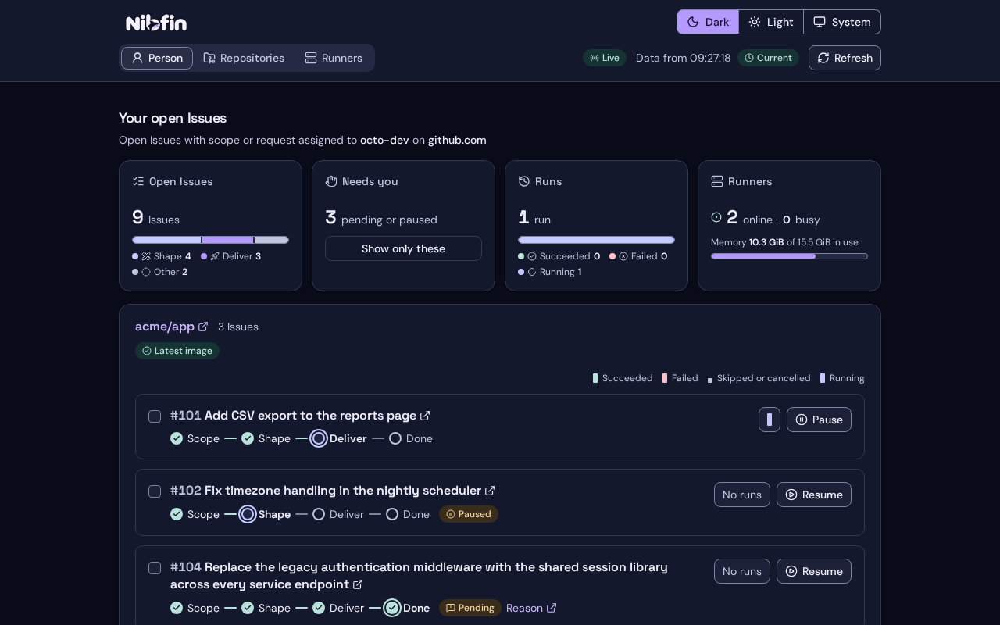
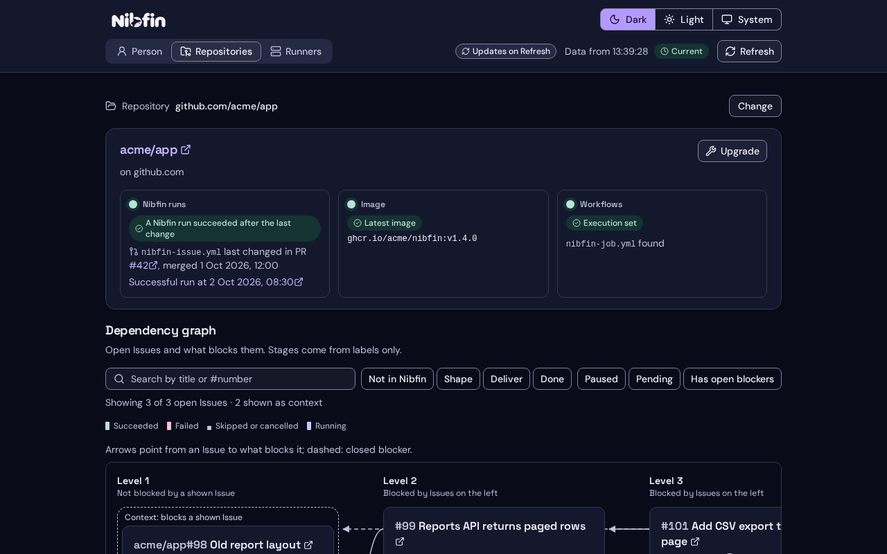
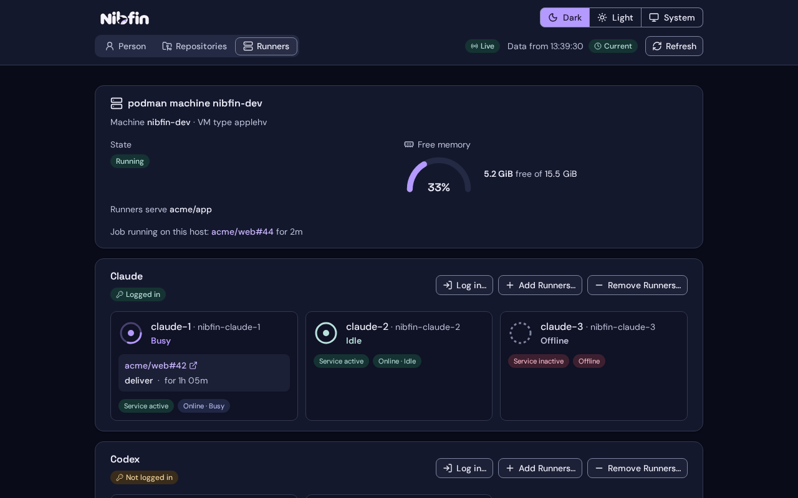

import { Steps, Tabs, TabItem } from '@astrojs/starlight/components';

This page covers running Nibfin day to day: the Runners that do the work, what a
Job can reach through the Claude login and how to limit it, adding your team,
how reviews fit in, the local Dashboard, and the per-repository
`.nibfin.json`. The [CLI commands](../cli/) page lists every command's flags and
arguments.

## Runners

A Runner is the official GitHub Actions runner, set up by gh nibfin to run
Nibfin's Jobs in Podman containers on your machine. On Linux the Runners live on
the host. On Windows and macOS they live inside the `podman machine` Linux VM.

### Adding Runners

[`gh nibfin runner add <claude|codex> [--count N]`](../cli/#runner-add) adds N
Runners for one provider, two by default.

<Steps>

1. **Run `gh nibfin runner add <claude|codex> [--count N]`** in the repository
   that becomes your execution repository.

2. **Log in when asked.** When the provider is not logged in yet, `runner add`
   runs [`login`](../cli/#login) for it.

3. **Run it again if it was interrupted.** An interrupted `runner add` is
   finished by running it again.

</Steps>

- The first Runner on a host registers to the repository of the current
  directory. That repository is your **execution repository**: every other
  repository you prepare with `init` sends its Jobs there. Later Runners reuse
  it from any directory.
- Each Runner gets the label `nibfin-<user id>`, your GitHub user id. A stage Job
  of an Issue assigned to you runs on a Runner with that label.
- Each Runner's `.env` names its provider as `NIBFIN_PROVIDER`, and the Job
  takes the provider from the Runner that picks it up. No Issue, repository
  variable or workflow input chooses it.

To use both providers, add Runners for each. To switch a provider, remove its
Runners and add Runners for the other.

### Always on

A Runner only takes Jobs while it runs, so `runner add` keeps it running while
the host is on. It never changes power or sleep settings.

<Tabs syncKey="platform">
  <TabItem label="Windows">

`runner add` sets `[wsl2] vmIdleTimeout=-1` in `%UserProfile%\.wslconfig`,
keeping your other settings, and adds the Task Scheduler task
`Nibfin podman machine`. The task starts the machine at logon and on resume
from sleep.

When the host's last Runner goes, the task goes with it. The `.wslconfig`
setting stays, since other WSL users may rely on it.

  </TabItem>
  <TabItem label="macOS">

`runner add` adds a LaunchAgent that starts the machine at login.

When the host's last Runner goes, the LaunchAgent goes with it.

  </TabItem>
  <TabItem label="Linux">

The Runners are systemd user services, and linger keeps them running after
you log out.

  </TabItem>
</Tabs>

### Removing Runners

[`gh nibfin runner remove <claude|codex> [--count N] [--delete-login]`](../cli/#runner-remove)
removes N Runners of a provider, all of them without `--count`.

- Runners left unfinished by an interrupted command go first, then idle ones. A busy Runner stops taking new Jobs and is removed
  after its Job ends; the command waits and never cancels the Job.
- Each removal deletes the GitHub registration, the service and the Runner's
  directory, then reads back how many remain.
- `--delete-login` also deletes the provider's login once no Runner of it
  remains on the host.

### Offline Runners

[`gh nibfin status`](../cli/#status) shows whether the machine runs and each
Runner's service against GitHub's online, offline and busy state. A Job for an
Assignee whose Runners are all offline waits in GitHub's queue for one of them;
it is not moved to someone else. A Job that waits past GitHub's queue limit
never starts, and the Issue waits until you wake it. See
[An offline Runner](../cli/#an-offline-runner).

### Choosing a Runner's model

Each Runner chooses the model its Jobs use, the same way it chooses its
provider:

- Add `NIBFIN_MODEL=<model>` to a Runner's `.env` to set the model for that
  Runner only. Without it, Core's default for the Runner's provider applies
  (Claude: Opus; Codex: the Codex CLI's own default). `runner add` does not
  write this line, and `runner add` and `upgrade` keep it.
- The runner reads its `.env` when it starts, so restart the Runner after a
  change.
- No repository variable chooses the model. An old `NIBFIN_MODEL` repository
  variable is unused and can be deleted.

## The Claude login and connectors

A Claude Runner's Jobs use the login stored in the `nibfin-home-claude` volume.
What that login can reach, a Job can reach too.

### What a Job loads

- With a claude.ai subscription login (`claude auth login`, what
  [`gh nibfin login`](../cli/#login) runs), every Job loads all the connectors
  you have connected on claude.ai.
- Jobs run Claude in `bypassPermissions` mode, so a Job can call any connector
  tool without a prompt.
- A setup token or an API key login loads no claude.ai connectors (see
  [Use MCP servers from claude.ai](https://code.claude.com/docs/en/mcp)).
- Codex logins do not load claude.ai connectors.

The Job log shows the agent's output unchanged. Its first `system` / `init`
event lists the MCP servers the Job loaded, with their exact names.

### Pointing the agent at your specification

A rule under `.rulesync/rules/` can tell the agent where your repository's
specification lives and which tool reads it. Connector tools load on demand, so
the rule names the tool to look for:

```md
---
root: true
targets: ["*"]
description: "Where this repository's specification is and how to read it"
globs: ["**/*"]
---

# Specification

The specification for this repository is <where it lives>.
Read it with the <tool name> tool before you rely on a requirement.
If the tool is not loaded yet, search for it by name first.
```

`.rulesync/` is a [protected path](#protected-paths): Nibfin's agents never
change it, so commit the rule yourself.

### Limiting connectors

Limit connectors in Claude's user settings: the `settings.json` at the root of
the `nibfin-home-claude` volume.

<Steps>

1. **Open a shell where the volume lives.**

   <Tabs syncKey="platform">
     <TabItem label="Windows">

     Run `podman machine ssh` first.

     </TabItem>
     <TabItem label="macOS">

     Run `podman machine ssh` first.

     </TabItem>
     <TabItem label="Linux">

     Run the next step on the host.

     </TabItem>
   </Tabs>

2. **Open `settings.json` in the volume.**

   ```sh
   cd "$(podman volume inspect nibfin-home-claude --format '{{.Mountpoint}}')"
   vi settings.json
   ```

   If access is denied, run `podman unshare vi settings.json` instead.

3. **Add the deny settings.** Keep the file a JSON object and keep the
   `enableAllProjectMcpServers` line Nibfin added.

   ```json
   {
     "enableAllProjectMcpServers": true,
     "deniedMcpServers": [
       { "serverName": "claude.ai Example" },
       { "serverUrl": "https://mcp.example.com/*" }
     ],
     "permissions": {
       "deny": [
         "mcp__claude_ai_Other__create_item",
         "mcp__claude_ai_Other__delete_item"
       ]
     }
   }
   ```

</Steps>

A file that is not a JSON object stops Jobs with `AGENT_CONFIG_INVALID`.

- **`deniedMcpServers`** keeps whole connectors out of Jobs. A `serverName`
  entry matches the connector's claude.ai display name exactly, and that name
  can change, so also add a `serverUrl` entry (`*` wildcards allowed) for the
  connector's server address.
- **`permissions.deny`** blocks single tools of a connector the Jobs still
  load, for example its write tools. `mcp__<server>__<tool>` names one tool and
  `mcp__<server>__*` names all of a server's tools. In `<server>`, spaces and
  dots become `_`, so `claude.ai Other` is written `claude_ai_Other`.
- **Use a deny list.** In `allowedMcpServers`, a `serverName` may only contain
  letters, numbers, hyphens and underscores, so connector names with spaces
  cannot be listed there.
- Both settings apply under `bypassPermissions`: deny rules block in every
  mode.
- After you connect a new connector on claude.ai, or one gains new write tools,
  add it to the deny list.

See Claude Code's [settings](https://code.claude.com/docs/en/settings),
[permissions](https://code.claude.com/docs/en/permissions) and
[MCP server limits](https://code.claude.com/docs/en/managed-mcp)
documentation.

### What keeps or removes these settings

- They live in the login volume, not in the image. Image updates and
  [`gh nibfin upgrade`](../cli/#upgrade) leave them as they are; Nibfin only
  merges `enableAllProjectMcpServers` into the file.
- [`gh nibfin runner remove claude --delete-login`](../cli/#runner-remove)
  deletes the whole volume, these settings included.

:::note[A harmless warning]
With `deniedMcpServers` in your user settings, Claude prints a line saying a
server is "blocked by enterprise policy" on stderr when it starts, so it shows
in the Job log. It comes from your own settings, not from an organization
policy, and does not affect the Job.
:::

## Collaborators' Runners

Team members can add their own Runners to your execution repository, so Issues
assigned to them run on their machines.

### Joining

<Steps>

1. **The Owner invites them.** Making someone a collaborator with write access
   to the execution repository approves their Runners. There is no other
   approval step.
2. **They add an SSH key to their GitHub account.** `runner add` needs a key
   pair in `~/.ssh` (`ssh-ed25519` or `ssh-rsa`) whose public key is on their
   account. Without one it stops before any change (`ssh_key_missing`) and
   names the steps: `ssh-keygen -t ed25519`, then
   `gh ssh-key add ~/.ssh/id_ed25519.pub` (run
   `gh auth refresh -s write:public_key` first when `gh` asks for it).
3. **They run `gh nibfin runner add <claude|codex>` in a clone of the execution
   repository.** Registering a Runner needs admin, so the command opens a
   `Nibfin runner request` Issue. The Owner's `nibfin-runner-request.yml`
   workflow checks the requester's write access, then answers with a
   registration token encrypted to their SSH key. `runner add` decrypts it on
   their host, registers, and closes the request. It waits up to 10 minutes for
   the answer.

</Steps>

**Private and public execution repositories.** Only a private execution
repository gets a deploy key. Before it opens the request, `runner add` creates
a dedicated read-only key on the collaborator's host and sends its public key.
The Owner's request workflow adds it to the repository as the deploy key
`nibfin-runner-<login>`. A public execution repository is read directly with no
key.

### Only official Jobs

A collaborator's Runners get a job-started hook. It lets a Job run only when it
comes from the execution repository's `nibfin-shared-runner.yml`, is assigned to
the Runner's owner, matches gh nibfin's official workflow templates, and uses a
signed official Nibfin image. Any other Job fails before its first step. On a
private repository the hook reads the workflow with the deploy key.

The hook keeps other workflows off the collaborator's host. It does not
protect against the code an official Job runs inside its container.

### Removing a collaborator's Runners

<Steps>

1. **The collaborator runs `gh nibfin runner remove`.** It only cleans their
   own host: GitHub lets only an admin delete registrations.

2. **The Owner deletes the Runner registrations** under
   **Settings → Actions → Runners**.

3. **On a private execution repository, the Owner deletes the deploy key**
   `nibfin-runner-<login>` under **Settings → Deploy keys**.

</Steps>

A collaborator's `gh nibfin status` shows their local services only. GitHub's
online and busy state needs admin, so it shows as `needs admin`.

:::caution[Only for teams that trust each other]
An official Job runs the Owner's repository code with the collaborator's
provider CLI login, and a collaborator's Jobs carry the Owner's Nibfin token, the
GitHub credential `init` stored as `NIBFIN_GITHUB_TOKEN`. Add collaborators'
Runners only within a team whose members trust each other with both.
:::

:::note[Windows]
On Windows the Runners live in a WSL-based VM, and WSL can read and write the
Windows user folder. gh nibfin does not change that setting.
:::

## Working with several people

Nibfin dispatches an Issue to one person, chosen from its Assignees each time
it dispatches.

### Who gets the Job

In the order GitHub lists the Assignees:

1. The first Assignee with an **online** Runner in the execution repository
   gets the Job. A busy Runner counts as online, and the Job queues on it.
2. If every Assignee's Runners are offline, the first Assignee who has **any**
   Runner gets the Job, and it waits until one of their Runners comes online.
3. If no Assignee has a Runner, it is an ordinary assignment: Nibfin does
   nothing and leaves no comment.

Changing the Assignees does not stop a queued or running run. The next dispatch
uses the new list. All runs of one Issue share a concurrency group, so an Issue
never has two Writers at once.

**Why one person.** A workflow's `runs-on` labels must
[all match](https://docs.github.com/en/actions/reference/workflows-and-actions/workflow-syntax)
one Runner, so a single Job cannot target several people's labels. Runner
groups, which could pool them, are an organization and enterprise feature.
So Nibfin picks the person first and targets their label.

### Consent before work starts

When an Issue's Assignees include anyone other than the execution repository's
Owner, Nibfin adds `pause` once and comments for each such Assignee, mentioning
them. It dispatches nothing yet. Each of them is asked once per Issue.

Removing `pause` is the go-ahead: read the Issue, then remove the label, or run
`gh nibfin resume <issue>`. This step is about consent, not security.

## Required reviews

Nibfin follows the merge rules your repository actually sets. When a ruleset on
the base branch requires approving reviews:

- After its own review passes, Nibfin waits for the approvals instead of
  adding `pending`. It comments on the pull request that it is waiting for
  approving reviews, with how many are required and who is requested.
- A review submitted on the pull request by someone with write or admin access
  wakes the Issue. An approval that meets the requirement lets Nibfin merge;
  changes requested send the Issue back to Deliver to address them.
- The reviewer can review by hand, or first with their own agent on their own
  machine. Either way the approval is their own GitHub account.

Existing repositories get the review trigger with
[`gh nibfin upgrade`](../cli/#upgrade).

:::caution[An Owner-only repository cannot require approvals]
Nibfin opens pull requests with the Owner's token, so the Owner is their
author, and GitHub does not let
[authors approve their own pull requests](https://docs.github.com/en/pull-requests/collaborating-with-pull-requests/reviewing-changes-in-pull-requests/approving-a-pull-request-with-required-reviews).
In a repository where only the Owner can review and approvals are required,
Nibfin's pull requests can never merge.
:::

## Dashboard

[`gh nibfin dashboard`](../cli/#dashboard) opens the same commands in your
browser. It listens on `127.0.0.1` only and opens a one-time session URL. The
first page that opens that URL gets the only session, with the same access as
your `gh` login, so keep the URL private and restart the command for a new
one.

It has three views. It opens on **Runners** while the host has no Runner yet,
with a guide to `runner add` and then `init`, and on **Person** otherwise.

### Person



Your open Issues with `scope`, grouped by repository. Each Issue shows its stage
from the labels, `pending` or `pause`, its Nibfin runs, and Pause or Resume. The
view updates live.

### Repositories



Pick one of your repositories that use Nibfin, or enter `OWNER/REPO`. It shows
whether a Nibfin run succeeded since the workflows last changed, the image the
workflows use, `init` or `upgrade`, and a graph of the open Issues and what
blocks them.

### Runners



The podman machine and its free memory, then each provider's login and Runners:
busy with which Issue, idle or offline. From here you add and remove Runners and
log in.

### Operations

Every change opens a dialog built from the command's own arguments. It shows a
plan with each item's current state and the result, marking those that need no
change, and runs only after you confirm. It then shows progress and reads every
change back; a failure shows its code and the next step. Pause and Resume apply
at once.

## `.nibfin.json`

An optional `.nibfin.json` at a repository's root describes the environment of
that repository's Jobs. It cannot choose who works on an Issue, the provider,
credentials or workflows, and it runs no scripts. Without the file the defaults
apply; an invalid file stops the affected Jobs with a readable diagnostic.

```json
{
  "tools": { "node": "22.15.0", "python": "3.13.7" },
  "skills": {
    "shape": { "mode": "extend", "path": ".nibfin/skills/shape/SKILL.md" },
    "deliver": { "mode": "override", "path": ".nibfin/skills/deliver/SKILL.md" }
  }
}
```

### `tools`

Versions of Node.js (`node`), Python (`python`) and Go (`go`) for the Job,
from a fixed, trusted tool catalogue. Nibfin runs no Dockerfile or install
script from the repository; your project's packages still come from its own
package manager.

### `skills`

Adjusts Nibfin's built-in role skills `shape`, `deliver` and `accept`.

- `extend` appends your file to the built-in instructions.
- `override` replaces them entirely and adds nothing back.

Any other skill name is refused. The `path` must
be a Markdown file inside the repository: unsafe paths, symbolic links that
leave the workspace and missing files are refused. A skill cannot change the
permissions or merge rules Core controls.

### Protected paths

Nibfin's agents never change these paths:

- `.github/workflows/`
- `.nibfin.json`
- `.nibfin/`
- `.rulesync/`
- the CODEOWNERS files
- the role skill files the base branch's `.nibfin.json` names, wherever they are

Before it pushes, Deliver checks the branch. A change to a protected path stops
it with `pending`, so the reviewed head always has the base branch's skills and
agent instructions. Change these files yourself, outside Nibfin.
